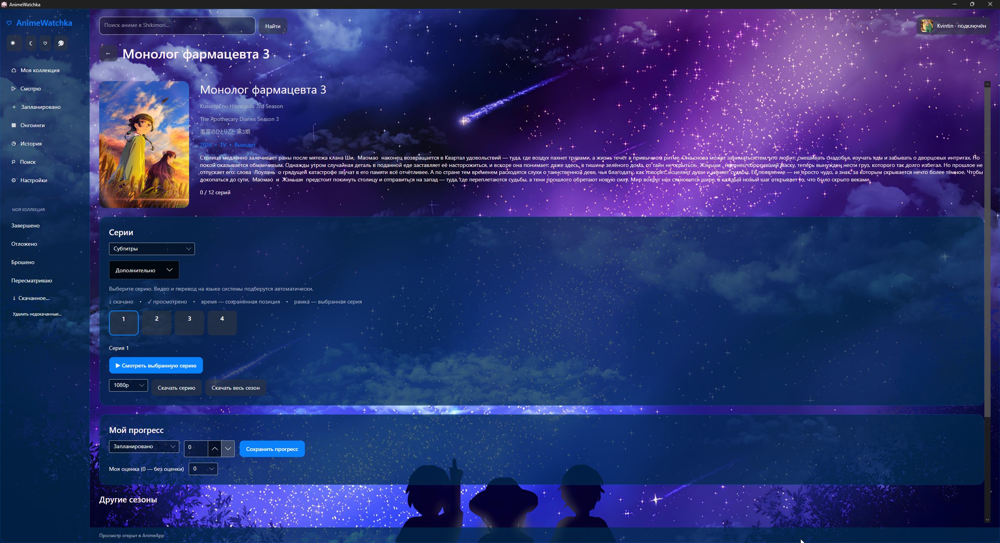

# 🌸 AnimeWatchka

**AnimeWatchka** — приложение для Windows 10/11, объединяющее аниме-библиотеку, источники озвучки, встроенный видеоплеер и персональное оформление.

Следите за любимыми аниме, сохраняйте прогресс просмотра, находите новые сериалы и выбирайте удобные источники воспроизведения — всё в одном приложении.

**Текущая тестовая версия: 0.2.1 Beta**

## 📥 Скачать и установить

**[Скачать AnimeWatchka — GitHub Releases](https://github.com/Alexkvintin/AnimeWatchka/releases)**

Для обычного использования собирать приложение самостоятельно не требуется.

### Установка

1. Откройте раздел [Releases](https://github.com/Alexkvintin/AnimeWatchka/releases).
2. Выберите последнюю доступную версию.
3. В разделе **Assets** скачайте установщик последней версии.
4. Запустите скачанный файл и следуйте инструкциям установщика.
5. После установки откройте AnimeWatchka.
6. При желании подключите аккаунт Shikimori и настройте предпочитаемые источники просмотра.

Приложение также можно использовать в гостевом режиме без подключения аккаунта.

### Системные требования

- **Операционная система:** Windows 10 или Windows 11 (64-bit).
- **Интернет:** необходим для поиска, синхронизации и онлайн-просмотра аниме.
- **Microsoft Edge WebView2 Runtime:** необходим для отдельных веб-функций приложения.
- **Видеокарта:** для режимов улучшения изображения рекомендуется современный графический драйвер и оборудование с поддержкой используемого видеовывода.

Для обычной установки не требуется отдельно устанавливать .NET SDK или инструменты разработки.

### Обновление приложения

Новые версии распространяются через GitHub Releases.

Для обновления скачайте установщик новой версии и установите его поверх предыдущей. Личные данные и настройки приложения должны сохраняться.

Перед обновлением рекомендуется полностью закрыть AnimeWatchka, включая значок приложения в системном трее.

---

## ✨ Возможности

### 🎬 Аниме-библиотека

- Подключение и синхронизация с Shikimori.
- Личная коллекция аниме с различными статусами просмотра.
- Сохранение просмотренных серий и пользовательских оценок.
- История просмотров и продолжение с сохранённой позиции.
- Поиск аниме и фильтрация каталога.


### 📺 Источники просмотра

Поддерживаются:

- **AnimeVost**
- **AniLibria / AniLiberty**
- **Glass Moon**
- **FanVoxUA**
- **Субтитры** — японская озвучка и отдельные дорожки перевода.
- **Локальные видеофайлы**


Можно выбирать доступные источники и настраивать их приоритет.

В источнике **«Субтитры»** достаточно выбрать серию: приложение само ищет подходящее видео через Nyaa и AnimeTosho и подбирает перевод. Воспроизведение торрента начинается во время загрузки, без ожидания полного файла. По умолчанию предпочтение отдаётся языку системы: украинскому, русскому или английскому для остальных языков.

В «Дополнительно» остаются ручное добавление magnet-ссылки или `.torrent`, подключение своих источников поиска, ограничения скорости и управление временным кэшем. Сторонние скрипты расширений Hayase не исполняются.



Доступность конкретного аниме, озвучки, серии и качества изображения зависит от выбранного источника.

### 📅 Онгоинги

- Отслеживание выходящих аниме и новых серий.
- Просмотр расписания доступных источников.
- Фильтрация по дням недели и другим параметрам.
- Быстрый переход к просмотру доступных серий.


Расписание зависит от информации, предоставляемой источниками, и может изменяться.

### 🎥 Встроенный видеоплеер

- Воспроизведение через **mpv**.
- Резервный совместимый режим на базе **VLC**.
- Выбор доступного качества видеопотока.
- Режимы масштабирования и улучшения изображения, включая **Anime4K**.
- Регулировка скорости воспроизведения.
- Полноэкранный просмотр.
- Перемотка и управление с клавиатуры.
- Сохранение позиции и продолжение просмотра.
- Выбор аудиодорожки; для просмотра с субтитрами предпочтительна японская.
- Автоматическое подключение переводов из **Anime365**, выбор другого перевода и регулировка задержки.
- Дополнительный поиск через **OpenSubtitles** после настройки своего API-ключа и аккаунта.
- Встроенные субтитры и свои файлы ASS/SSA, SRT и VTT; включение и отключение кнопкой **CC**.
- Настройки шрифта и размера текста, готовые стили «Стандартный», «Манга», «Иероглифный» и импорт TTF/OTF. В mpv можно сохранять авторское оформление ASS/SSA.


Возможности улучшения изображения зависят от выбранного движка, оборудования и графического драйвера.

### 💾 Загрузка и офлайн-просмотр

- Скачивание выбранной серии или всего доступного сезона одной кнопкой; уже скачанные серии пропускаются.
- Автоматическое сохранение в папку `Downloads` рядом с приложением или в папку, выбранную в настройках.
- Раздел «Скачанное» с обложками тайтлов, кнопками серий и отображением процесса загрузки.
- Отмена скачивания.
- Очистка незавершённых загрузок.
- Просмотр загруженных серий без интернета.
- Сохранение найденных субтитров выбранного языка рядом с видео для офлайн-просмотра.
- Отметки скачанных серий в карточке аниме и запуск с диска с учётом выбранной озвучки.

Сезон скачивается последовательно, по одной серии. Для офлайн-субтитров перевод должен быть доступен во время скачивания; для старых загрузок он не появляется задним числом.


### 🎨 Персонализация оформления

- Светлая и тёмная темы.
- Дополнительные цветовые схемы.
- Фирменное оформление с маскотом **Луми (Lumi)**.
- Пользовательские изображения и замена Луми на своего PNG- или GIF-персонажа.
- Настройка элементов интерфейса и цветовой палитры.
- До трёх пользовательских пресетов оформления с сохранением, выбором и перезаписью.
- Экспорт и импорт тем в формате `.awtheme`, включая встроенные изображения.


## ⚠️ Важная информация о бета-версии

AnimeWatchka находится в активной разработке и распространяется как **Beta**.

Возможны:

- Ошибки и нестабильная работа отдельных функций.
- Проблемы совместимости с некоторыми компьютерами и графическими драйверами.
- Временная недоступность отдельных источников аниме.
- Изменения пользовательского интерфейса между версиями.
- Неполная реализация некоторых запланированных возможностей.

Доступность контента зависит от сторонних источников. AnimeWatchka не гарантирует постоянную доступность конкретных релизов, озвучек или видеопотоков.

### Текущие ограничения

- Очередь скачивания сезона обрабатывает одну серию за раз.
- Возобновление прерванной обычной загрузки пока не поддерживается; временный торрент-кэш управляется отдельно.
- Загрузка защищённых HLS-потоков и отдельных аудиодорожек не реализована.
- Скорость запуска и плавность торрент-просмотра зависят от доступных участников раздачи и соединения. Наличие раздачи в поиске не гарантирует её доступность.
- Нужный язык субтитров может отсутствовать. OpenSubtitles требует настройки и имеет ограничения сервиса; синхронизацию перевода иногда нужно корректировать задержкой.
- Для переноса скачанного HLS-видео необходимо сохранять всю папку серии.
- Офлайн-просмотр пока не отправляет прогресс в Shikimori.
- GIF-персонажи поддерживаются, но анимированные фоны находятся в планах.
- Anime4K работает через совместимый mpv и недоступен в резервном режиме VLC.
- Совместимость со старым оборудованием продолжает проверяться.
- Android-версия запланирована на будущее; готовой версии и даты выпуска пока нет.

---

## 🐛 Ошибки и предложения

Нашли ошибку или хотите предложить новую функцию?

**[Создать обращение в GitHub Issues](https://github.com/Alexkvintin/AnimeWatchka/issues)**

При сообщении об ошибке желательно указать:

- Версию AnimeWatchka.
- Версию Windows.
- Что именно произошло.
- Какие действия привели к проблеме.
- Скриншот или описание ошибки, если это возможно.

Не прикладывайте пароли, токены авторизации и другие конфиденциальные данные.

Обратная связь помогает находить ошибки, улучшать совместимость и определять приоритеты будущих обновлений.

Приложение разрабатывается одним автором. Набор команды разработчиков не ведётся, но отзывы, сообщения об ошибках и предложения пользователей приветствуются.

---

## 🛠️ Разработка и сборка из исходников

Репозиторий содержит исходный код приложения, тесты, ресурсы и инструменты сборки.

Личные настройки, ключи, пользовательские базы данных, журналы и готовые установщики в Git не хранятся.

### Необходимые инструменты

Для сборки из исходников требуются:

- Windows x64.
- [.NET SDK 10](https://dotnet.microsoft.com/download/dotnet/10.0).
- [Git](https://git-scm.com/).
- [7-Zip](https://www.7-zip.org/) для подготовки нативных компонентов.
- [Inno Setup 6](https://jrsoftware.org/isinfo.php) — если требуется собрать установщик.

### Сборка приложения

Клонируйте репозиторий и выполните команды в PowerShell:

```powershell
git clone https://github.com/Alexkvintin/AnimeWatchka.git
cd AnimeWatchka

./tools/Prepare-Native.ps1

dotnet restore AnimeApp.slnx

dotnet build AnimeApp.slnx -c Release

dotnet test AnimeApp.Tests/AnimeApp.Tests.csproj -c Release --filter 'Category!=Live&Category!=Native&Category!=AccountLive'

dotnet run --project AnimeApp/AnimeApp.csproj -c Release --no-build
```

`Prepare-Native.ps1` загружает закреплённую сборку mpv из upstream и проверяет SHA-256 соответствующей DLL. Нативная библиотека размером около 115 МиБ не включена в Git.

VLC, Avalonia, MonoTorrent и остальные зависимости восстанавливаются через NuGet. Если 7-Zip установлен в другом месте, передайте путь через `./tools/Prepare-Native.ps1 -SevenZip 'D:/Tools/7-Zip/7z.exe'`.

Указанная команда тестирования исключает сетевые, нативные и аккаунтные проверки. Эти проверки требуют отдельного окружения; обычный запуск тестов не подтверждает доступность всех внешних источников.

### Авторизация Shikimori для разработчиков

Для собственного подключения Shikimori при разработке необходимо настроить OAuth-приложение и сервис обмена токенов.

Подробности: [auth-worker/README.md](auth-worker/README.md).

**Никогда не добавляйте Client Secret, пользовательские токены или другие секреты в клиентское приложение, установщик либо публичный репозиторий.**

Гостевой режим доступен без настройки авторизации.

### Сборка установщика

Для сборки установщика с собственным подключением Shikimori скопируйте:

`installer/oauth-public.example.json`

в:

`installer/oauth-public.json`

Затем настройте публичные параметры OAuth-приложения, если необходим вход в аккаунт.

Локальная конфигурация исключена из Git. Для гостевой сборки этот файл не требуется. Скрипт самостоятельно публикует приложение для Windows x64 вместе с .NET runtime.

Запустите:

```powershell
./installer/Build.ps1 -Compiler 'C:/Program Files (x86)/Inno Setup 6/ISCC.exe'
```

Готовый установщик появится в:

`artifacts/installer/`

Постоянный AppId позволяет устанавливать обновления поверх предыдущих версий с сохранением пользовательских данных.

---

## 📚 Документация

- [История изменений](CHANGELOG.md)
- [Отзывы и сообщения об ошибках](CONTRIBUTING.md)
- [Сторонние компоненты и лицензии](AnimeApp/Assets/Licenses/THIRD-PARTY.txt)

## 💕 Спасибо за поддержку!

AnimeWatchka продолжает развиваться.

Спасибо всем, кто тестирует приложение, сообщает об ошибках, предлагает новые возможности и помогает делать его удобнее.

**Сделано с любовью к аниме.** 🌸

